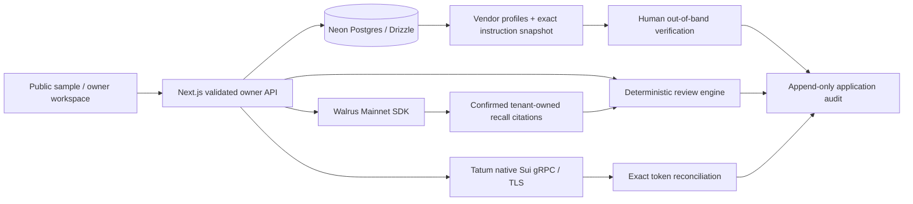

# PayGuard Verify

**Verify the instruction before trusting the payment.** Built on the existing PayGuard AI application and official branding.

PayGuard Verify helps a human reviewer investigate supplier payment-instruction changes. It compares proposed recipients with independently established vendor profiles, flags observable business email compromise (BEC) patterns, records out-of-band verification, and recalls approved policies from Walrus Memory. Tatum Sui Mainnet gRPC supplies separate chain evidence. **A successful transfer does not establish supplier identity or authorize an instruction.** No supplier payment is ever initiated.

This is a working implementation under verification, not a claim of completed Mainnet acceptance. There is no deployed URL or fabricated proof. See [Mainnet evidence](docs/MAINNET_PROOF.md) and [handoff](docs/HANDOFF.md) for the current gates. The root master prompt currently still contains the original specification; the owner's subsequent PayGuard Verify direction is implemented and documented in [scope](docs/VERIFY_SCOPE.md).

## What is implemented

- Responsive landing page and workspace, official brand assets, reduced-motion support, keyboard-friendly dialogs and mobile navigation.
- Public, read-only sample workspace plus authenticated owner workspace. Private data and paid/live integration operations require server-verified sessions.
- Vendor trust profiles: established recipient, supplier email domain, known contact/channel, establishment date and revision history in the audit log.
- Payment instruction capture: sender/reply-to, received time, request-supplied contact and message. These are user-entered records, not authenticated email headers.
- Recipient comparison, domain/reply-to mismatch, urgency/secrecy and verification-bypass signals. Findings cite evidence and require human action; they are not fraud probabilities.
- Human callback/in-person/established-portal attestation. Changes to invoice terms, instructions or trust-profile revision invalidate prior verification. Row locks protect approval/verification against concurrent edits.
- Attack Replay Lab with four clearly synthetic scenarios, including a normal control. Patterns are grounded in [FBI BEC guidance](https://www.fbi.gov/how-we-can-help-you/common-frauds-and-scams/business-email-compromise).
- Editable manual/PDF/TXT/CSV intake; exact/possible duplicate checks, threshold rules and amount history. Raw uploads are not retained or sent to Walrus.
- Neon + Drizzle persistence, 19 tables, additive migrations, tenant-scoped records, append-only application audit, idempotent sample seeding.
- Walrus SDK 0.1.10 adapter: durable operation keys, accepted-job persistence, pending/confirmed/failed states, resumable polling, exact provenance checks on recall, 12 distinct synthetic-event write jobs.
- **Native HTTP/2 + TLS gRPC** to Tatum using the installed Sui SDK v2 generated services and server-only `x-api-key`. Service identity, balances, transaction inspection, metadata and bounded candidate streams. No legacy JSON-RPC fallback.
- Exact BigInt reconciliation: execution, network identity, intended recipient, token identity/decimals, exact agreed amount, gas-payer exclusion and database-enforced digest/invoice uniqueness.

## Run locally

Node 22.13+ is recommended (tested on Node 22.23.1).

```bash
npm ci
cp .env.example .env.local
# Privately configure values in .env.local; never paste secrets in chat or commit them.
npm run db:migrate
npm run db:seed-demo
npm run dev
```

Open `http://localhost:3000`. The public demo requires no database or wallet. Owner workflows require a configured database and authentication. Set `APP_URL` to the exact browser origin for CSRF checks.

Required owner variables: `DATABASE_URL`, `AUTH_SECRET`, `OWNER_PASSWORD`, `APP_URL`. Live memory additionally needs `MEMWAL_PRIVATE_KEY` (delegate only), `MEMWAL_ACCOUNT_ID`, and `MEMWAL_SERVER_URL` (managed Mainnet default). Live chain reads need `TATUM_API_KEY`. Optional proof metadata: `MEMWAL_AGENT_ID`; optional read-only transaction check: `TATUM_TEST_DIGEST`. No LLM key is needed. `OPENAI_API_KEY` is reserved; this build does not call an LLM.

[Complete integration and deployment guide](docs/INTEGRATION_GUIDE.md).

For **local QA only**, `LOCAL_DATABASE_PATH=/tmp/payguard-qa` opts into persistent PostgreSQL WASM (PGlite) when `DATABASE_URL` is absent. This is explicitly labeled and is not Neon or Mainnet proof. Vercel disallows this fallback; live memory requires Neon.

## Test and inspect

```bash
npm run db:generate       # Only after schema changes; inspect the generated SQL
npm run typecheck
npm run lint
npm test
npm run build
npm run start
npm run test:e2e          # Server must be running; public browser tests
# Optional: E2E_OWNER_PASSWORD privately enables the owner/new-session persistence test
npm run check:live       # Read-only; reports missing credentials honestly
npm run proof:export     # Neon evidence → gitignored .data/mainnet-proof.json
```

Unit/integration tests use synthetic chain responses and a mocked Walrus provider. They test correctness, not actual Mainnet writes. Browser tests are also not proof of live cross-session Walrus learning. See [validation](docs/VALIDATION.md).

## Architecture



No architecture path signs or submits a supplier payment. A human review approval and a confirmed chain match are distinct records.

## Demo and submission

Follow [the 2–3 minute demo script](docs/DEMO_SCRIPT.md). The crucial live sequence is: Memory OFF → changed supplier instruction → human correction → **completed Walrus job with blob ID** → later invoice → fresh authenticated browser session → actual semantic recall → Memory ON/OFF comparison.

At least ten completed Mainnet memories and a real Tatum response remain submission gates until evidence is recorded in [MAINNET_PROOF.md](docs/MAINNET_PROOF.md). The [article draft](docs/HACKATHON_ARTICLE_DRAFT.md) must be completed with real evidence before publication. No x402/MPP bonus is claimed.

## Security and limitations

- Single-owner password authentication, hashed session identifiers, secure cookies on HTTPS, strict same-site and explicit origin checks. Database-backed quotas constrain login and live operations. Guest live writes are disabled.
- Contacts and verification outcomes are human attestations. PayGuard cannot prove a callback happened, authenticate email, inspect SPF/DKIM, guarantee a wallet is trustworthy, or prevent payment outside this app.
- Messages are checked with transparent deterministic patterns, not an exhaustive BEC detector. Attackers may evade these checks; normal messages may trigger them.
- Walrus stores minimized fixed policy templates and pseudonymous references, not raw instructions or invoice documents. Local explanations remain private in Neon. Indexing/relevance can delay recall; no recall means no learned soft policy application. Hard rules remain active with memory off.
- Memory retention is epoch-based and may need renewal. Reset/deletion in the app does not erase Walrus blobs or audit history. The application provides no global erasure guarantee.
- Tatum may disable methods or prune historical data. Candidate stream failures are visible and do not replace real balances with demo data. Sender/gas-payer recipient cases and non-exact transfers require manual review.
- Audit events are append-only through the application, not cryptographically immutable against a database administrator. Operational backup, monitoring, account recovery, multi-user onboarding and independent penetration testing remain outside this MVP.

Official brand files are preserved in the repository and copied to `public/brand`. Built with Next.js, React, Tailwind, Motion, Lucide, Drizzle, Neon, Walrus Memory, Sui SDK and Tatum. MIT license.
