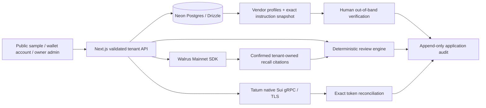

# PayGuard Verify

**Verify before you pay. Remember what nearly went wrong.** Supplier payment-instruction review, with human accountability and remembered context.

**Wallet security gate:** Slush has reportedly flagged the production origin. Hosted wallet onboarding and new service-payment signing are paused pending review; do not override wallet warnings. The public demo and owner workspace remain available. The public [/connect review-only selector](https://payguard-ai-henna.vercel.app/connect) can reach Slush’s own **Flag for review**; it never signs, registers or authenticates. Do not accept the connection or override a warning. [Investigation, evidence and prepared Slush review request](docs/SLUSH_SECURITY_REVIEW.md).

PayGuard Verify helps a human reviewer investigate supplier payment-instruction changes. It compares proposed recipients with independently established vendor profiles, flags observable business email compromise (BEC) patterns, records out-of-band verification, and recalls approved policies from Walrus Memory. Tatum Sui Mainnet gRPC supplies separate chain evidence. **A successful transfer does not establish supplier identity or authorize an instruction.** No supplier payment is ever initiated. A separate owner-only Sui Mainnet x402 service-purchase implementation is spending-disabled and security-paused; no settlement is claimed.

The application is deployed and production-tested; wallet security and funded service settlement remain explicitly unresolved. **30 original Walrus Mainnet memories are preserved, plus two confirmed controlled tenant proofs (32 tracked total); real semantic recall passed across a fresh owner browser session; Tatum gRPC inspected a real transaction and correctly rejected a false invoice match.** See [the proof ledger](docs/MAINNET_PROOF.md), [test results](docs/TEST_RESULTS.md), and [handoff](docs/CODEX_HANDOFF.md). The production application is public at https://payguard-ai-henna.vercel.app/. Owner browser login, secure cookies, Neon persistence across a new session, live Walrus recall and Tatum Mainnet gRPC passed on production; [fresh production core evidence](docs/evidence/production-core-smoke.json). Wallet fixtures and tenant boundaries are tested locally; current hosted wallet onboarding is paused pending Slush review. Two new controlled customer sessions used real Neon and Walrus Mainnet successfully; this does not certify a physical production wallet. No supplier payment or positive live payment match is claimed. The updated October 27 PayGuard Verify specification was merged safely from GitHub.

## Judge? Start Here

**PayGuard Verify — Verify before you pay. Remember what nearly went wrong.**

| Explore                           | Link and actual status                                                                                                                                                            |
| --------------------------------- | --------------------------------------------------------------------------------------------------------------------------------------------------------------------------------- |
| Public three-minute judge sandbox | [Try PayGuard Verify](https://payguard-ai-henna.vercel.app/try) — no account, funds or credentials; same judge component and protection logic, recorded genuine provider evidence |
| Next.js application               | [PayGuard workspace](https://payguard-ai-henna.vercel.app) — public synthetic workspace; private records require sign-in                                                          |
| Next.js judge route               | [/try on the application](https://payguard-ai-henna.vercel.app/try) — public guided seven-step journey                                                                            |
| Guided instructions               | [Judge walkthrough and troubleshooting](docs/JUDGE_WALKTHROUGH.md)                                                                                                                |
| Walrus Mainnet                    | [30 confirmed job/blob records](docs/MAINNET_PROOF.md) · [Raw evidence](docs/evidence/walrus-confirmed.json)                                                                      |
| Actual remembered decisions       | [Recorded semantic recall](docs/evidence/judge-recall.json) · [Live quality evaluation](docs/MEMORY_EVALUATION.md)                                                                |
| Tatum Sui Mainnet                 | [Real transaction and mismatch evidence](docs/evidence/tatum-reconciliation.json)                                                                                                 |
| Verification and architecture     | [Tests](docs/TEST_RESULTS.md) · [Architecture](docs/ARCHITECTURE.md)                                                                                                              |
| Technical article                 | [Published engineering report](https://sopskistar.github.io/payguard-ai/)                                                                                                         |
| Agent-service payments            | [Mainnet implementation, preflight and spending gates](docs/AGENT_PAYMENTS.md) — no settled-payment award claim                                                                   |
| Release and security status       | [Feature-by-feature completion and blockers](docs/RELEASE_STATUS.md) · [Slush review case](docs/SLUSH_SECURITY_REVIEW.md)                                                         |

The homepage now includes a six-stage **synthetic product illustration** with Play, Pause, Replay and keyboard step selection. It shows the recipient change, approval hold, independent human check and the reason to remember a correction. The public memory comparison uses genuine dated recall evidence through the application’s review logic; no anonymous provider request or write occurs. The operational dashboard separates current server-evaluated holds, saved workspace activity, personal confirmed jobs and the published **30 + 2** Mainnet proof.

**Current validation:** 111 unit/integration tests; local browser 18 passed / 0 failed / 3 environment skips; every hosted spec in isolated Chromium processes 18 passed / 0 failed / 3 security skips. Lint, TypeScript, format and production build pass. The earlier shared-browser transport failures are retained in the [test ledger](docs/TEST_RESULTS.md).

Access is explicit: **Public demo** requires nothing; **regular wallet onboarding** remains security-paused; **Owner Sign In** is private administrator access. A public review-only wallet connection creates no application session. [Release UX, screenshots and validation](docs/PRODUCT_RELEASE.md) · [Exact payment approval worksheet—currently incomplete](docs/MAINNET_PAYMENT_APPROVAL.md).

The public practice uses synthetic invoices and a synthetic callback. Its Walrus citations and Tatum receipt are dated, authentic captured results. It performs no guest memory writes, provider requests or supplier payments. Real owner review decisions are stored in Neon; the sandbox audit is local practice state.

[Connect Sui Wallet](https://payguard-ai-henna.vercel.app/connect) explains the current security pause. Registration, returning-user login and isolated workspaces are implemented and tested with controlled unfunded identities; production physical-wallet onboarding remains blocked pending Slush review. Connection alone is not authentication. [Privacy and retention](https://payguard-ai-henna.vercel.app/privacy) · [Account security](docs/WALLET_SECURITY.md). Owner Sign In remains administrator-only.

The [Memory Learning Report](https://payguard-ai-henna.vercel.app/proof#learning) measures 18 authored synthetic scenarios using four genuine recalls. The initial run found three false alarms; the corrected run met 18/18 specified contracts, preserved all baseline findings and added zero critical warnings across four unchanged controls. This is a small contract evaluation, not a real-world fraud accuracy claim. [Before](docs/evidence/learning-before.json) · [After](docs/evidence/learning-report.json).

**Latest verified application (`2571cea`): 110 unit tests; full production browser suite 14 passed, 0 failed, 3 security-paused wallet skips.** Owner/Neon, new-session Walrus recall, Tatum and unsigned Mainnet preflight passed live. Physical wallet onboarding and genuine service settlement remain unproven. [Current completion matrix](docs/RELEASE_STATUS.md) · [Browser evidence](docs/evidence/production-browser-mainnet.json).

## What is implemented

- Responsive landing page and workspace, official brand assets, reduced-motion support, keyboard-friendly dialogs and mobile navigation.
- Public synthetic workspace, isolated wallet accounts, and a separate owner administrator workspace. Wallet Standard connection is followed by a server-verified, one-time, domain/browser-bound personal-message challenge. Private data and paid/live integration operations require server-verified sessions.
- Vendor trust profiles: established recipient, supplier email domain, known contact/channel, establishment date and revision history in the audit log.
- Payment instruction capture: sender/reply-to, received time, request-supplied contact and message. These are user-entered records, not authenticated email headers.
- Recipient comparison, domain/reply-to mismatch, urgency/secrecy and verification-bypass signals. Findings cite evidence and require human action; they are not fraud probabilities.
- Human callback/in-person/established-portal attestation. Changes to invoice terms, instructions or trust-profile revision invalidate prior verification. Row locks protect approval/verification against concurrent edits.
- Attack Replay Lab with seven clearly synthetic scenarios, including a normal control. Patterns are grounded in [FBI BEC guidance](https://www.fbi.gov/how-we-can-help-you/common-frauds-and-scams/business-email-compromise).
- Editable manual/PDF/TXT/CSV intake; exact/possible duplicate checks, threshold rules and amount history. Raw uploads are not retained or sent to Walrus.
- Neon + Drizzle persistence, 23 tables, additive migrations, tenant-scoped records, append-only application audit, idempotent sample seeding.
- Walrus SDK 0.1.10 adapter: durable operation keys, accepted-job persistence, pending/confirmed/failed states, resumable polling, exact provenance checks on recall, 30 preserved owner memories plus two separately confirmed controlled tenant-isolation memories; [two-user proof](docs/evidence/two-tenant-mainnet-memory.json).
- **Native HTTP/2 + TLS gRPC** to Tatum using the installed Sui SDK v2 generated services and server-only `x-api-key`. Service identity, balances, transaction inspection, metadata and bounded candidate streams. No legacy JSON-RPC fallback.
- Exact BigInt reconciliation: execution, network identity, intended recipient, token identity/decimals, exact agreed amount, gas-payer exclusion and database-enforced digest/invoice uniqueness.

## Run locally

Node 22.13+ is recommended (tested on Node 22.23.1).

```bash
npm ci
cp .env.example .env.local
# Privately configure values in .env.local; never paste secrets in chat or commit them.
npm run db:migrate
npm run db:seed-demo
npm run dev
```

Open `http://localhost:3000`. The public demo requires no database or wallet. Owner workflows require a configured database and authentication. Set `APP_URL` to the exact browser origin for CSRF checks.

Required owner variables: `DATABASE_URL`, `AUTH_SECRET`, `OWNER_PASSWORD`, `APP_URL`. Live memory additionally needs `MEMWAL_PRIVATE_KEY` (delegate only), `MEMWAL_ACCOUNT_ID`, and `MEMWAL_SERVER_URL` (managed Mainnet default). Live chain reads need `TATUM_API_KEY`. Optional proof metadata: `MEMWAL_AGENT_ID`; optional read-only transaction check: `TATUM_TEST_DIGEST`. No LLM key is needed. `OPENAI_API_KEY` is reserved; this build does not call an LLM.

[Complete integration and deployment guide](docs/INTEGRATION_GUIDE.md).

For **local QA only**, `LOCAL_DATABASE_PATH=/tmp/payguard-qa` opts into persistent PostgreSQL WASM (PGlite) when `DATABASE_URL` is absent. This is explicitly labeled and is not Neon or Mainnet proof. Vercel disallows this fallback; live memory requires Neon.

## Test and inspect

```bash
npm run db:generate       # Only after schema changes; inspect the generated SQL
npm run typecheck
npm run lint
npm test
npm run build
npm run start
npm run test:e2e          # Server must be running; public browser tests
# Optional: E2E_OWNER_PASSWORD privately enables the owner/new-session persistence test
npm run check:live       # Read-only; reports missing credentials honestly
npm run proof:export     # Neon evidence → gitignored .data/mainnet-proof.json
```

Unit/integration tests use synthetic chain responses and a mocked Walrus provider. They test correctness, not actual Mainnet writes. The separately enabled `LIVE_MEMORY_TEST=1` browser test uses real Mainnet and passed; ordinary browser tests do not prove it. See [test results](docs/TEST_RESULTS.md).

## Architecture



No architecture path signs or submits a supplier payment. A human review approval and a confirmed chain match are distinct records.

## Demo and submission

Follow [the 2–3 minute demo script](docs/DEMO_SCRIPT.md). The crucial live sequence is: Memory OFF → changed supplier instruction → human correction → **completed Walrus job with blob ID** → later invoice → fresh authenticated browser session → actual semantic recall → Memory ON/OFF comparison.

The ten-memory gate and fresh-session recall are evidenced in [MAINNET_PROOF.md](docs/MAINNET_PROOF.md). The [technical article is published](https://sopskistar.github.io/payguard-ai/). Public app and judge access are available. The owner will arrange the demo video separately; this build creates no video. The [article source](docs/HACKATHON_ARTICLE_DRAFT.md) includes measured results and genuine screenshots. The Mainnet x402 implementation includes exact native-SUI terms, durable session caps and Tatum receipt checks; spending remains disabled, Slush review is pending, and genuine settlement/bonus remain unproven.

## Security and limitations

- Wallet personal-message authentication plus a separate administrator password login; hashed session identifiers, eight-hour expiry, secure HttpOnly cookies on HTTPS, strict same-site and explicit origin checks. Database-backed quotas constrain login and live operations. Guest live writes are disabled.
- Contacts and verification outcomes are human attestations. PayGuard cannot prove a callback happened, authenticate email, inspect SPF/DKIM, guarantee a wallet is trustworthy, or prevent payment outside this app.
- Messages are checked with transparent deterministic patterns, not an exhaustive BEC detector. Attackers may evade these checks; normal messages may trigger them.
- Walrus stores minimized fixed policy templates and pseudonymous references, not raw instructions or invoice documents. Local explanations remain private in Neon. Indexing/relevance can delay recall; no recall means no learned soft policy application. Hard rules remain active with memory off.
- Memory retention is epoch-based and may need renewal. Reset/deletion in the app does not erase Walrus blobs or audit history. The application provides no global erasure guarantee.
- Tatum may disable methods or prune historical data. Candidate stream failures are visible and do not replace real balances with demo data. Sender/gas-payer recipient cases and non-exact transfers require manual review.
- Audit events are append-only through the application, not cryptographically immutable against a database administrator. Operational backup, monitoring, account recovery, organization/team roles, mobile device certification and independent penetration testing remain outside this MVP.

Official brand files are preserved in the repository and copied to `public/brand`. Built with Next.js, React, Tailwind, Motion, Lucide, Drizzle, Neon, Walrus Memory, Sui SDK and Tatum. MIT license.
