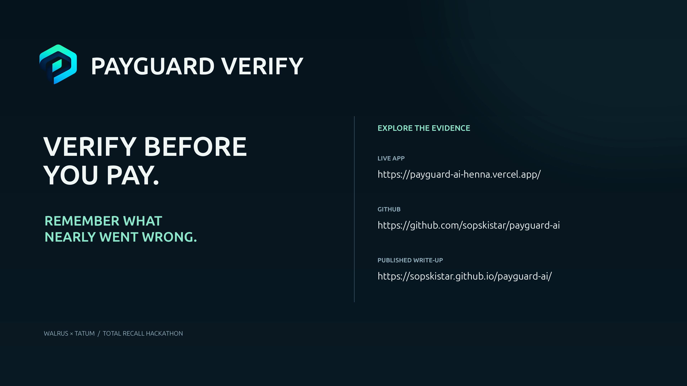
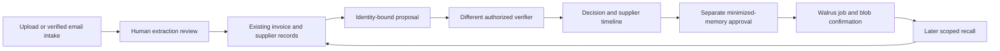

# PayGuard Verify

**Verify before you pay. Remember what nearly went wrong.**

PayGuard Verify helps a business compare supplier payment instructions with its established records, keep changed destinations on hold, and record an independent human check. Approved, minimized policies can be recalled through Walrus Memory during later reviews.

[Live app](https://payguard-ai-henna.vercel.app/) · [Approved demo](https://youtu.be/i2ZsEPIegy4) · [Interactive walkthrough](https://payguard-ai-henna.vercel.app/try) · [Memory Courtroom](https://payguard-ai-henna.vercel.app/courtroom) · [Mainnet proof](https://payguard-ai-henna.vercel.app/proof) · [Technical article](https://sopskistar.github.io/payguard-ai/)

[](https://youtu.be/i2ZsEPIegy4)

The approved video shows the earlier submitted version. The business intake, timeline and maker-checker features described below are subsequent additions.

## The problem

An invoice looks familiar, but the bank account or payment address has changed. A convincing email, a valid address and a familiar supplier name do not establish who controls the destination.

PayGuard makes the difference visible and retains the human verification requirement. It supports a careful review; it does not guarantee fraud prevention or authenticate a supplier automatically.

## How it works

1. Upload an invoice or enter its details. Review extracted fields against the source.
2. Compare the proposed destination with the supplier’s established reference.
3. Inspect changed recipients, conflicting instructions, payment links and embedded bypass requests.
4. In a business workspace, submit a verification request to a different authorized identity.
5. Record the independently obtained evidence and decision in the supplier timeline.
6. Propose a minimized policy for separate, consent-based Walrus learning.
7. On a later review, distinguish retrieved memory from context that actually influenced the result.

## Invoice intake and forwarding

Invoice Inbox accepts **PDF, PNG, JPEG, WebP, UTF-8 text and single-row CSV**. Text PDFs use deterministic extraction. Images and scanned PDFs use a bundled English OCR engine; the document is not sent to an external OCR or LLM service.

Extracted fields remain suggestions. Missing and conflicting values require review, supplier-name matches do not establish trust, and a document never creates a trusted destination automatically. Source previews are rendered pixels, and embedded links are displayed without being opened.

Uploads are limited to **3 MB**, with at most **15 PDF pages** or **3 scanned pages**. Raw originals are processed ephemerally by default. Optional retained attachments use private Vercel Blob storage behind tenant-authorized routes.

The Resend inbound integration verifies raw webhook signatures, binds an unpredictable intake address to one workspace, deduplicates messages and handles attachments through the same review flow. **Live forwarding requires owner configuration and a real inbound acceptance test.** It is disabled when the receiving domain, provider credentials, webhook secret or private storage is absent. [Intake and setup boundaries](docs/BUSINESS_WORKFLOWS.md).

## Supplier Change Timeline

Vendor Trust and Team Verification show a chronological supplier history: invoice arrivals and edits, recipient changes, proposals, decisions, invalidations and learning events.

Database audit records and Walrus confirmation evidence are labeled separately. Memory entries include retained job/blob/namespace references, applicability and actual retrieval/application timestamps where recorded. Missing historical actors or evidence are shown as unknown rather than reconstructed.

## Two-Person Verification

A business administrator explicitly adds existing, wallet-authenticated identities as **requester**, **verifier** or **organization administrator**. Members share authorized business records; personal service-payment workspaces and payer permissions remain separate.

A requester cannot approve the same proposal, even after changing roles. The server checks current membership, serializes approval and revocation, binds the decision to the exact invoice instructions and supplier revision, and invalidates it after material changes. Legacy mutation routes retain these business safeguards.

An approved supplier change **does not authorize a blockchain payment**. A human attestation records what the verifier asserts; PayGuard does not observe a callback or guarantee that two wallets represent two different people. [Workflow and security design](docs/BUSINESS_WORKFLOWS.md).

## Walrus Memory

The November 5 verification confirms **50 distinct Walrus Mainnet blobs and 50 confirmed application memory records**, with no pending or failed jobs. The exact owner-approved 16-record synthetic batch completed through the existing sponsored integration; the older provider-completed customer row was reconciled through its legitimate owning workspace without another write. All original 33 confirmed references remain preserved. [Per-record job/blob and retrieval evidence](docs/evidence/approved-business-memory-verified-1793916025290.json).

Every new record was retrieved with matching decrypted text in a fresh verification process. All **16 expanded policy contracts** and the existing **18/18 live-recall contracts** passed, retaining baseline holds and excluding stale or wrong-scope guidance. These are authored contract evaluations, not real-world fraud-detection accuracy scores. Retained history includes superseded and expired guidance; 50 memories does not mean 50 simultaneously applicable rules. [Approved batch](docs/BUSINESS_MEMORY_BATCH.md) · [methodology](docs/MEMORY_EVALUATION.md).

The public Courtroom continues to show its dated, captured comparison. Current private recall and recorded public evidence remain distinct.

## Tatum and x402 evidence

Three developer-controlled Sui Mainnet service purchases each credited the merchant **0.001 SUI**, with **three persisted reports and receipts**. Tatum provides independent native Sui gRPC verification; saved reports can be reopened without another charge. [Settlement evidence](docs/MAINNET_PROOF.md).

[Transaction 1](https://suivision.xyz/txblock/68bhHRKzrQang8xohsahBQbehoZ4SjApQJ1U1Wf2ppyx) · [Transaction 2](https://suivision.xyz/txblock/xASYnWVeftLraQ2RvxMR6oPndU3r7UoBrX9Z9KPJd9r) · [Transaction 3](https://suivision.xyz/txblock/4NxNL1sekFUNxpiu6ebhTtwdkT5UXnsiMsnhcPNK1tGA)

These are controlled experiments using synthetic invoices. **Physical Nightly customer financial-signing acceptance remains unverified.** A separate local test-wallet acceptance runner requires two typed terminal approvals and never treats an SDK signature as Nightly extension acceptance. A connection-only account match is not a finalized payment. Supplier invoice verification and the optional first-party analysis purchase have separate authorization and accounting. [Payment boundaries](docs/AGENT_PAYMENTS.md).

## Try the product

No wallet, payment or account is needed for the [public walkthrough](https://payguard-ai-henna.vercel.app/try), [Memory Courtroom](https://payguard-ai-henna.vercel.app/courtroom) or [recorded proof](https://payguard-ai-henna.vercel.app/proof).

For private records, [sign in](https://payguard-ai-henna.vercel.app/connect) with a supported wallet’s free personal-message signature. Use **Invoice Inbox** for intake, **Vendor Trust** for established references and history, and **Team Verification** for shared maker-checker review. Every teammate signs in independently. No financial purchase is required to test business verification.

## Architecture



| Technology                                       | Role                                                                               |
| ------------------------------------------------ | ---------------------------------------------------------------------------------- |
| Next.js, TypeScript, Neon and Drizzle            | Application, tenant-scoped records, transactions and audit history                 |
| PDF.js through pdf-parse, Sharp and Tesseract.js | Bounded document parsing, safe pixel previews and local English OCR                |
| Private Vercel Blob and Resend                   | Optional retained originals and signed inbound-email intake                        |
| Wallet Standard and Sui                          | Personal-message authentication and separately approved service-payment signatures |
| Walrus Memory                                    | Consented policy persistence, confirmed provenance and scoped recall               |
| Tatum and x402                                   | Independent transaction verification and optional paid analysis                    |

The review engine is deterministic. The application does not call an LLM at runtime. [Architecture](docs/ARCHITECTURE.md) · [integration guide](docs/INTEGRATION_GUIDE.md).

## Run locally

Use Node.js **22.13 or later** and npm.

```bash
git clone https://github.com/sopskistar/payguard-ai.git
cd payguard-ai
npm ci
npm run dev
```

Open `http://localhost:3000/try` for the public synthetic demo. For private development, configure a new database and local environment using the [setup guide](docs/INTEGRATION_GUIDE.md). Never seed or reset Production for testing.

```bash
npm test
npm run typecheck
npm run lint
npm run build
npm run test:intake:package
npm run test:e2e:qa
```

The QA runner creates a disposable local database and disables live payment, memory, storage and email credentials. Tests cover document extraction, tenant isolation, maker-checker identity and concurrency, provenance, wallet adapter/payer binding and settlement integrity. Physical wallet acceptance and real provider configuration are reported separately. [Current results](docs/TEST_RESULTS.md).

Release validation: **320 unit/integration passes**, **62 browser passes with two deliberate live-provider skips**, isolated serverless PDF/OCR acceptance, and the deployed synthetic maker-checker workflow. [Verified release and remaining owner actions](docs/AUTHORIZED_ACCEPTANCE_2026-11-05.md).

OCR can misread payment details; human source review remains mandatory. No antivirus service is claimed. Private attachment retention and live email require owner setup. Increasing the memory count does not establish better fraud detection.

## Documentation

- [Business workflow and security](docs/BUSINESS_WORKFLOWS.md)
- [Judge walkthrough](docs/JUDGE_WALKTHROUGH.md)
- [Architecture](docs/ARCHITECTURE.md)
- [Integration guide](docs/INTEGRATION_GUIDE.md)
- [Memory evaluation](docs/MEMORY_EVALUATION.md)
- [Mainnet proof](docs/MAINNET_PROOF.md)
- [Testing](docs/TEST_RESULTS.md)
- [Wallet security](docs/WALLET_SECURITY.md)

## License

[MIT](LICENSE).
