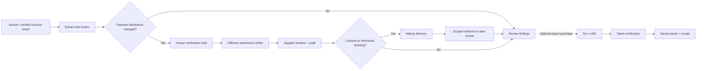

# PayGuard Verify

**The invoice looks familiar. The payment destination changed. Who checked it?**

PayGuard helps businesses catch changes to supplier payment instructions **before anyone pays**. It compares a new invoice with an established supplier reference, holds unexplained changes for independent human verification, and remembers approved guidance so the same warning is not lost when another invoice arrives.

**[Try the live walkthrough](https://payguard-ai-henna.vercel.app/try)** · **[Watch the 2:46 demo](https://youtu.be/i2ZsEPIegy4)** · [Memory ON vs OFF](https://payguard-ai-henna.vercel.app/courtroom) · [Mainnet proof](https://payguard-ai-henna.vercel.app/proof) · [Technical write-up](https://sopskistar.github.io/payguard-ai/)

[](https://youtu.be/i2ZsEPIegy4)

> **Start here if you are judging:** [Three-minute walkthrough](docs/JUDGE_WALKTHROUGH.md). The public demo, memory comparison and proof page require **no wallet, account or payment**. The video shows the original hackathon submission; business intake, timeline and maker-checker features were added afterward.

## The problem

A business has paid a supplier for months. Today another invoice arrives with the same name and branding—but a different bank account or crypto destination. Someone in accounts payable is busy, the invoice is due, and the email says the recipient changed.

The hard question is not **“Can we extract the payment details?”** It is **“Who independently confirmed that the supplier changed them?”**

Ordinary invoice processing can make entering the new destination easier. PayGuard makes the changed instruction harder to overlook, without pretending a document, email sender or model can establish the supplier's identity.

## Follow one invoice

| Moment | What PayGuard does | What it does **not** assume |
| --- | --- | --- |
| **1. Invoice arrives** | Accepts PDF/image upload, forwarded email, or manual entry; extracts fields for source review | OCR output or a familiar name is a verified destination |
| **2. Destination changes** | Compares proposed instructions with the established supplier reference and shows discrepancy findings | A new instruction should silently replace a trusted one |
| **3. Team checks** | Requires a different authorized identity to review a sensitive change; records the exact proposal and decision | The requester may approve their own change |
| **4. Learning is approved** | Stores minimized, consented verification guidance in Walrus with scope and provenance | The raw invoice should become public/shared memory |
| **5. Next invoice** | Retrieves applicable memory, excludes expired or superseded guidance, and keeps human approval safeguards | Recalled memory alone authorizes a payment |

**The key behavior:** PayGuard remembers the *verification rule*—for example, independently confirm a changed destination using an established contact method—rather than learning to trust whatever account was printed most recently.

The scenario is illustrative. PayGuard has not demonstrated a measured real-world fraud-prevention rate.

## See it work in three minutes

| Open | What to look for |
| --- | --- |
| **[Public walkthrough](https://payguard-ai-henna.vercel.app/try)** | Established recipient vs proposed recipient, risk findings, and the human-verification hold |
| **[Memory Courtroom](https://payguard-ai-henna.vercel.app/courtroom)** | Experiment 3: the recorded **Memory OFF** run yielded no citations; **Memory ON** returned seven relevant citations, while the mandatory hold remained |
| **[Mainnet proof](https://payguard-ai-henna.vercel.app/proof)** | Real Sui service settlements, receipts and recorded Walrus evidence—not a simulated screenshot |
| **[Judging guide](docs/JUDGE_WALKTHROUGH.md)** | Exact three-minute route, evidence boundaries, and links for further inspection |

The Courtroom comparison is a **dated November 1 replay**, not anonymous live retrieval. Fresh-session Walrus reads and their separate tests are documented in the repository.

## Why Walrus Memory is part of the product

Without durable, scoped memory, a verifier may rediscover the same supplier-payment lesson every time an invoice changes. PayGuard makes that lesson reusable **without allowing memory to replace human approval**.

1. A human records a verification decision or correction.
2. The business separately approves a **minimized policy**, excluding raw invoice documents by default.
3. Walrus persists the encrypted application memory; the application retains the confirmed job, blob, namespace, ownership and retrieval evidence.
4. Later reviews retrieve policy context by appropriate scope.
5. Application checks exclude wrong-tenant, wrong-supplier, expired or superseded guidance before it can influence the review.

**A test that matters:** synthetic memory cases include a prior false positive that is corrected, an obsolete supplier policy that must be excluded, and a destination change that still requires a new check. The tests verify *which guidance is allowed to apply*, not just whether text can be retrieved.

The verified November 5 checkpoint contains **50 provider-verified Walrus Mainnet blobs and 50 confirmed application records**. All 16 newly approved synthetic records passed fresh-session exact retrieval and policy applicability contracts; the existing 18-case live-recall contract suite also passed. These are controlled evaluations, **not** real-world fraud-detection accuracy measurements.

[Memory evaluation methodology](docs/MEMORY_EVALUATION.md) · [Approved memory batch](docs/BUSINESS_MEMORY_BATCH.md) · [Per-record provider evidence](docs/evidence/approved-business-memory-verified-1793916025290.json)

## What is running

| Capability | Actual implementation |
| --- | --- |
| **Invoice Inbox** | PDF, PNG, JPEG, WebP, text and single-row CSV intake; bounded PDF extraction and local English OCR; editable source-reviewed fields |
| **Live email forwarding** | Real external synthetic email accepted through signed Resend webhook, routed to the correct workspace, extracted and retained privately |
| **Supplier Change Timeline** | Recipient history, proposals, decisions, invalidations and provenance with separate audit and Walrus evidence |
| **Two-Person Verification** | Distinct authenticated requester/verifier identities; server-side self-approval prevention, role checks and invalidation after material changes |
| **Memory ON/OFF evidence** | Reproducible recorded comparisons plus independently verified provider reads and scope tests |
| **Optional analysis reports** | Sui/x402 wallet checkout with readiness before quoting, Tatum-verified merchant credit, persisted receipts and automatic original-payment reconciliation |

The **supplier-instruction verification flow does not charge or send supplier payments**. The separate optional **0.001 SUI** purchase is for a PayGuard analysis report.

## Sponsor integration — and what each part proves

| Technology | Why PayGuard uses it | Evidence to inspect |
| --- | --- | --- |
| **Walrus Memory** | Durable, consented policies that can be recalled, corrected, scoped and superseded across reviews | [50 confirmed records and exact retrieval checks](docs/BUSINESS_MEMORY_BATCH.md) |
| **Sui Mainnet + x402** | Optional customer-approved payment for first-party analysis, independent of supplier instructions | [Recorded executed transactions and reports](docs/MAINNET_PROOF.md) |
| **Tatum native Sui gRPC** | Independent verification of finalized chain execution and the expected merchant credit before receipt/report delivery | [Tatum proof](docs/TATUM_PROOF.md) |
| **Neon, Resend and private Vercel Blob** | Workspace records, genuine inbound invoice delivery, and tenant-restricted attachment retention | [Live email acceptance](docs/LIVE_EMAIL_ACCEPTANCE_2026-11-08.md) |

**Sui Mainnet proof:** Real PayGuard service purchases settled on Sui Mainnet, with **0.001 SUI merchant credit per recorded purchase** independently checked through Tatum. Reports and receipts are persisted and reopenable. Automatic confirmation also delivered a previously pending browser purchase without a replacement charge.

[Transaction 1](https://suivision.xyz/txblock/68bhHRKzrQang8xohsahBQbehoZ4SjApQJ1U1Wf2ppyx) · [Transaction 2](https://suivision.xyz/txblock/xASYnWVeftLraQ2RvxMR6oPndU3r7UoBrX9Z9KPJd9r) · [Transaction 3](https://suivision.xyz/txblock/4NxNL1sekFUNxpiu6ebhTtwdkT5UXnsiMsnhcPNK1tGA) · [Detailed settlement evidence](docs/MAINNET_PROOF.md)

## Verification results

| Test or acceptance | Result | What it establishes |
| --- | --- | --- |
| Unit and integration | **337/337 passed** | Application logic, access rules, memory/payer boundaries and delivery safeguards |
| Complete browser suite | **64 passed**, 2 deliberate provider skips | Product behavior under local browser tests, not fresh Mainnet transactions |
| Focused customer checkout | **32/32 passed** | Wallet readiness, delayed confirmation, duplicate protection and receipt reopening |
| Mobile checkout checks | **2/2 passed** | Phone-sized readiness and confirmation states |
| Live invoice-email acceptance | **Verified** | One genuine PDF received, privately stored, extracted and presented for administrator review |
| Walrus Mainnet memory | **50 confirmed** | Provider-verified records, alongside separately documented retrieval/evaluation contracts |

[All validation details](docs/TEST_RESULTS.md) · [Final handover](docs/FINAL_HANDOVER.md)

The test runs have separate scopes. Full setup, provider boundaries and acceptance notes are documented in [Test Results](docs/TEST_RESULTS.md).

## Architecture



**Stack:** Next.js, TypeScript, Neon Postgres, Drizzle, PDF parsing, Sharp, Tesseract.js, Resend, private Vercel Blob, Sui, x402, Tatum and Walrus Memory. Invoice review is deterministic; there is **no runtime LLM call**.

## Run it yourself

Node.js **22.13+** and npm:

```bash
git clone https://github.com/sopskistar/payguard-ai.git
cd payguard-ai
npm ci
npm run dev
```

Visit [localhost:3000/try](http://localhost:3000/try) for the public synthetic walkthrough. Private workspace testing requires separate local credentials and a non-Production database; follow the [integration guide](docs/INTEGRATION_GUIDE.md).

```bash
npm test
npm run typecheck
npm run lint
npm run build
npm run test:intake:package
npm run test:e2e:qa
```

## Safeguards and scope

PayGuard keeps extracted instructions subject to source review, records independent authorization for sensitive supplier changes, and does not turn recalled memory into payment authority. Private documents are tenant-restricted with scheduled retention cleanup. Wallet payments and supplier verification remain separate.

For precise test boundaries, supported configurations, the first scheduled cleanup run and operational exceptions, see [business workflows](docs/BUSINESS_WORKFLOWS.md), [customer checkout](docs/CUSTOMER_CHECKOUT_2026-11-09.md) and [final handover](docs/FINAL_HANDOVER.md).

## License

[MIT](LICENSE).
