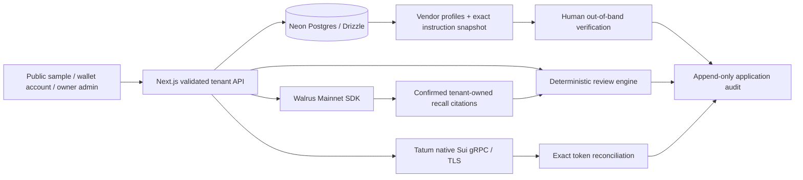

# PayGuard Verify

**Verify before you pay. Remember what nearly went wrong.** Supplier payment-instruction review, with human accountability and remembered context.

## HOW TO TEST PAYGUARD VERIFY

### Option A — Try in under three minutes

Open [the live app](https://payguard-ai-henna.vercel.app/) or go directly to **[the interactive demo](https://payguard-ai-henna.vercel.app/try)**. No wallet, account, funds or credentials are required. Use **Next Step** through these seven stages:

1. Open the synthetic Northstar invoice and inspect its supplier reference.
2. Compare the established recipient with the changed recipient, character by character.
3. Click **Try approving this invoice** and see the mandatory approval hold.
4. Record the clearly synthetic human attestation; edit instructions to see that prior verification becomes invalid.
5. Select **Memory ON** and expand **Inspect the actual recalled policies & receipts** to see the remembered correction and genuine recorded Walrus blob IDs. **Memory OFF** retains mandatory checks.
6. Inspect the recorded Tatum Mainnet result: the transaction succeeded but did not pay the sample invoice. **Mismatch** is the correct result.
7. Click **Record review decision**, then **Finish walkthrough**. Practice decisions stay in the sandbox.

Use **Back** to revisit a stage. The [proof page](https://payguard-ai-henna.vercel.app/proof) and [judge walkthrough](docs/JUDGE_WALKTHROUGH.md) distinguish synthetic business scenarios from genuine dated blockchain evidence. The homepage also has a six-stage Play/Pause/Replay illustration.

### Option B — Test a private workspace

Open **[Connect Sui Wallet](https://payguard-ai-henna.vercel.app/connect)**, choose a permitted Wallet Standard provider, connect deliberately, select **Prepare sign-in message**, inspect the exact origin/account/expiry and then **Sign message & open workspace**. This free personal signature creates your isolated account the first time and recognizes the same account on later visits. Connection alone is not authentication. Login never signs a transaction or grants administrator access.

**Slush restriction:** Production’s Slush classification remains unresolved. Slush is excluded from normal hosted login; its [review-only flow](https://payguard-ai-henna.vercel.app/connect?mode=review) remains available. Never override a wallet warning. Other providers may authenticate only if they permit the origin. The [inspected local application workflow](docs/LOCAL_OWNER_PAYMENT.md) supports the owner’s existing Slush Google account and does not clear the Production domain. Physical production-wallet compatibility is not certified.

Inside your own workspace:

1. Open **Vendor Trust** (`/app/vendors`), **Create supplier**, then establish the recipient/contact reference using information obtained independently of the invoice.
2. Open **Invoice Inbox** (`/app/invoices`), select **Add invoice**, add a manual invoice or review imported fields, and **Save & review invoice**. Use labeled synthetic data when testing; do not send customer documents to a public demo.
3. In **Verify Instructions** (`/app/review`), save changed instructions, inspect the side-by-side recipient comparison and record an actual out-of-band verification outcome. App approval remains distinct from any onchain transfer.
4. Select **Correct this assessment**. Choose a narrow rule, enable **Change future behavior through Walrus Memory**, review the minimized payload and explicitly consent before **Save correction & remember**. Only a confirmed job with job/blob IDs counts; resume pending jobs in **Memory Lab** instead of duplicating them.
5. Sign out, return with the same wallet, introduce a related but different invoice and compare Memory OFF/ON in a fresh review. Inspect returned citations; no applicable recall means no remembered soft policy is applied. Mandatory holds remain.

Live Walrus writes need configured server delegate access/quota and explicit consent. Local QA without provider credentials still supports private invoice workflows but cannot claim live recall. **Owner Sign In** is a separate private administrator workflow; no owner credentials are published. **Agent Services** (`/services`) restricts paid experiments to that administrator and the configured dedicated payer.

### Option C — Inspect real blockchain integration

- [Walrus proof](https://payguard-ai-henna.vercel.app/proof#memory): 30 original confirmed owner records plus [two controlled tenant records](https://payguard-ai-henna.vercel.app/proof#isolation), **32 total**. Inspect actual job/blob IDs, tenant separation and [fresh-session recall evidence](docs/evidence/final-x402-existing-memory-recall.json).
- [Tatum Mainnet evidence](https://payguard-ai-henna.vercel.app/proof#chain): real native gRPC results, chain identity and exact reconciliation. A successful chain transaction does not prove supplier identity.
- [Confirmed Wallet A self-deposit](docs/SUI_SELF_DEPOSIT_RESULT.md): [`6MXocsgenJghaAG5J7AAE9FqAEdkhrkjXgq13SiuBnMP`](https://suiscan.xyz/mainnet/tx/6MXocsgenJghaAG5J7AAE9FqAEdkhrkjXgq13SiuBnMP), checkpoint **339863005**. This moved 0.005 SUI within Wallet A into address balance; it is **not an x402 service payment**. Do not repeat it.
- [x402 evidence and limitations](docs/FINAL_X402_READINESS.md): genuine HTTP 402 quotes and unsigned Mainnet simulation exist. **Zero genuine service settlements are recorded before the owner-approved purchase.** Positive receipt/report tests are simulations. Actual receipts will appear on the authenticated saved service intent and audit history only after Tatum confirms finalized merchant credit and Neon persists the result.

Follow each receipt’s Mainnet explorer link or copy its full digest into SuiScan. Compare network, success, sender, asset, exact merchant credit and gas owner with the approved terms. The owner can independently query Tatum from authenticated workflows. No API key is exposed to judges.

### Option D — Run the repository locally

Prerequisites: **Node 22.13+**, npm and Git. The public demo needs no wallet/database; private QA uses bundled PGlite, while genuine Mainnet memory/payment workflows require configured Neon and provider credentials. In a new checkout:

```bash
git clone https://github.com/sopskistar/payguard-ai.git
cd payguard-ai
npm ci
test -f .env.local || cp .env.example .env.local
npm run dev
```

Open **http://localhost:3000/try**. Never clone over an existing working tree or overwrite its `.env.local`.

For a **new isolated local QA database only**, privately set `.env.local` names `APP_URL=http://localhost:3000`, `AUTH_SECRET` (at least 32 random characters), `OWNER_PASSWORD` (at least 16), `DATABASE_URL=` and `LOCAL_DATABASE_PATH=/tmp/payguard-judge-qa`. Use a password manager; do not paste values into chat/logs. Generate a session secret privately with `openssl rand -hex 32`. Then:

```bash
npm run db:migrate
npm run db:seed-demo
npm run dev
```

This seeds synthetic examples into **your new local QA database**. Do not run migration/seed/reset commands against the existing Production database for judging. For your own new Neon installation, configure `DATABASE_URL` instead, review migrations and follow [the integration guide](docs/INTEGRATION_GUIDE.md).

Server-only live configuration names: `DATABASE_URL`, `AUTH_SECRET`, `OWNER_PASSWORD`, `APP_URL`, `TATUM_API_KEY`; Walrus additionally uses `MEMWAL_PRIVATE_KEY` (**authorized delegate, never a spending-wallet key**), `MEMWAL_ACCOUNT_ID` and `MEMWAL_SERVER_URL`. No LLM API key is needed. See [.env.example](.env.example).

```bash
npm run lint
npm run typecheck
npm test -- tests/service-protocol.test.ts tests/service-store.test.ts tests/wallet-auth.test.ts
npm run build
npm run start
# In another terminal, with the server running:
npm run test:e2e -- tests/e2e/judge.spec.ts
```

Financial fixtures are isolated tests, not Mainnet proof. For genuine owner-local Mainnet preparation in the existing configured checkout, use `npm run owner:local`; [the exact supervised purchase procedure](docs/LOCAL_OWNER_PAYMENT.md) explains the separate live-capability flag and per-quote wallet approval. Quote mode is the literal `ENABLE_AGENT_PAYMENTS=mainnet`; `true` is invalid. Production `SERVICE_PAYMENT_SETTLEMENT_ENABLED=false` stays unchanged. Both existing wallet addresses remain configured.

Testnet is development only: `ENABLE_AGENT_PAYMENTS=testnet` needs a separate test recipient, a Testnet-capable wallet/facilitator and Tatum Testnet access. Obtain test SUI only through the [official Sui faucet instructions](https://docs.sui.io/guides/developer/getting-started/get-coins). Testnet SUI cannot fund Mainnet; the demonstrated integrations and existing owner funds are Mainnet. No faucet or funding is needed for the public demo or mocked tests.

**Quick troubleshooting:** A disabled quote requires checking Payment Setup and the literal quote mode; balance refresh works without it. Coin-object funds do not equal usable address balance. A provider error displays its failed stage; unknown balances are never zero. A pending payment must resume the original digest, never be paid again. A Slush warning must be respected. Missing memories require checking the original job and indexing, not another write. For stale browser assets, reload; verify the deployed commit at [`/api/release`](https://payguard-ai-henna.vercel.app/api/release). [Current release](docs/RELEASE_STATUS.md) · [test results and retained failures](docs/TEST_RESULTS.md).

---

**Wallet security gate:** Slush has reportedly flagged the production origin. Slush hosted login and production service-payment signing remain paused; permitted personal-message login is separate. The public demo and owner workspace remain available. The [/connect?mode=review selector](https://payguard-ai-henna.vercel.app/connect?mode=review) can reach Slush’s own **Flag for review**; that review mode never signs, registers or authenticates. Do not accept a review connection or override a warning. [Investigation](docs/SLUSH_SECURITY_REVIEW.md) · [owner-local application](docs/LOCAL_OWNER_PAYMENT.md).

PayGuard Verify helps a human reviewer investigate supplier payment-instruction changes. It compares proposed recipients with independently established vendor profiles, flags observable business email compromise (BEC) patterns, records out-of-band verification, and recalls approved policies from Walrus Memory. Tatum Sui Mainnet gRPC supplies separate chain evidence. **A successful transfer does not establish supplier identity or authorize an instruction.** No supplier payment is ever initiated. A separate owner-only Sui Mainnet x402 service-purchase implementation is spending-disabled and security-paused; no settlement is claimed.

The application is deployed and production-tested; wallet security and funded service settlement remain explicitly unresolved. **30 original Walrus Mainnet memories are preserved, plus two confirmed controlled tenant proofs (32 tracked total); real semantic recall passed across a fresh owner browser session; Tatum gRPC inspected a real transaction and correctly rejected a false invoice match.** See [the proof ledger](docs/MAINNET_PROOF.md), [test results](docs/TEST_RESULTS.md), and [handoff](docs/CODEX_HANDOFF.md). The production application is public at https://payguard-ai-henna.vercel.app/. Owner browser login, secure cookies, Neon persistence across a new session, live Walrus recall and Tatum Mainnet gRPC passed on production; [fresh production core evidence](docs/evidence/production-core-smoke.json). Wallet fixtures and tenant boundaries are tested locally; Slush hosted onboarding remains restricted pending its review; permitted providers have a separate authentication flow. Two new controlled customer sessions used real Neon and Walrus Mainnet successfully; this does not certify a physical production wallet. No supplier payment or positive live payment match is claimed. The updated October 27 PayGuard Verify specification was merged safely from GitHub.

Private owner wallet configuration: [Payment Setup](docs/PAYMENT_SETUP.md) · [prepared experiments](docs/PAYMENT_EXPERIMENTS.md) · [session recovery matrix](docs/SESSION_RECOVERY.md). Both wallets already exist. Settlement remains disabled.

**Balance checker corrected:** both existing Production wallets are configured and verified. Read-only checks handle provider rate limits and omitted zero fields, preserve partial results and show safe stage diagnostics. Fresh October 31 checks found Mainnet quotes enabled and settlement disabled. [Original defect](docs/BALANCE_CHECK_FIX.md) · [current provider evidence](docs/evidence/oct31-readiness.json).

## Judge? Start Here

Current Mainnet payment status: [genuine 402 quotes, unsigned sponsor simulation and final owner workflow](docs/FINAL_X402_READINESS.md). Quotes are enabled; production signing is security-paused and **no paid-service settlement is claimed**.

**PayGuard Verify — Verify before you pay. Remember what nearly went wrong.**

| Explore                           | Link and actual status                                                                                                                                                            |
| --------------------------------- | --------------------------------------------------------------------------------------------------------------------------------------------------------------------------------- |
| Public three-minute judge sandbox | [Try PayGuard Verify](https://payguard-ai-henna.vercel.app/try) — no account, funds or credentials; same judge component and protection logic, recorded genuine provider evidence |
| Next.js application               | [PayGuard workspace](https://payguard-ai-henna.vercel.app) — public synthetic workspace; private records require sign-in                                                          |
| Next.js judge route               | [/try on the application](https://payguard-ai-henna.vercel.app/try) — public guided seven-step journey                                                                            |
| Guided instructions               | [Judge walkthrough and troubleshooting](docs/JUDGE_WALKTHROUGH.md)                                                                                                                |
| Walrus Mainnet                    | [30 confirmed job/blob records](docs/MAINNET_PROOF.md) · [Raw evidence](docs/evidence/walrus-confirmed.json)                                                                      |
| Actual remembered decisions       | [Recorded semantic recall](docs/evidence/judge-recall.json) · [Live quality evaluation](docs/MEMORY_EVALUATION.md)                                                                |
| Tatum Sui Mainnet                 | [Real transaction and mismatch evidence](docs/evidence/tatum-reconciliation.json)                                                                                                 |
| Verification and architecture     | [Tests](docs/TEST_RESULTS.md) · [Architecture](docs/ARCHITECTURE.md)                                                                                                              |
| Technical article                 | [Published engineering report](https://sopskistar.github.io/payguard-ai/)                                                                                                         |
| Agent-service payments            | [Mainnet implementation, preflight and spending gates](docs/AGENT_PAYMENTS.md) — no settled-payment award claim                                                                   |
| Release and security status       | [Feature-by-feature completion and blockers](docs/RELEASE_STATUS.md) · [Slush review case](docs/SLUSH_SECURITY_REVIEW.md)                                                         |

The homepage now includes a six-stage **synthetic product illustration** with Play, Pause, Replay and keyboard step selection. It shows the recipient change, approval hold, independent human check and the reason to remember a correction. The public memory comparison uses genuine dated recall evidence through the application’s review logic; no anonymous provider request or write occurs. The operational dashboard separates current server-evaluated holds, saved workspace activity, personal confirmed jobs and the published **30 + 2** Mainnet proof.

**Recovery validation:** 116 unit/integration tests; local browser 20 passed / 0 failed / 3 skips; latest full production 18 passed / 2 Chromium transport failures / 3 security skips, then 2 focused passes / 1 additional transport failure; lint, TypeScript, formatting and production build pass. Production application `3b55319` is verified. Earlier failures remain in [the release/test ledgers](docs/RELEASE_STATUS.md); physical hosted wallet signing and genuine settlement remain unproven.

Access is explicit: **Public demo** requires nothing; **permitted wallet authentication** creates a private member account; **Owner Sign In** is private administrator access. Slush remains restricted on Production. A public review-only wallet connection creates no application session. [Release UX, screenshots and validation](docs/PRODUCT_RELEASE.md) · [exact payment approval worksheet](docs/MAINNET_PAYMENT_APPROVAL.md).

The public practice uses synthetic invoices and a synthetic callback. Its Walrus citations and Tatum receipt are dated, authentic captured results. It performs no guest memory writes, provider requests or supplier payments. Real owner review decisions are stored in Neon; the sandbox audit is local practice state.

[Connect Sui Wallet](https://payguard-ai-henna.vercel.app/connect) explains provider restrictions and offers permitted personal-message authentication. Registration, returning-user login and isolated workspaces are implemented and tested with controlled unfunded identities; physical Production Slush onboarding remains blocked pending review. Connection alone is not authentication. [Privacy and retention](https://payguard-ai-henna.vercel.app/privacy) · [Account security](docs/WALLET_SECURITY.md). Owner Sign In remains administrator-only.

The [Memory Learning Report](https://payguard-ai-henna.vercel.app/proof#learning) measures 18 authored synthetic scenarios using four genuine recalls. The initial run found three false alarms; the corrected run met 18/18 specified contracts, preserved all baseline findings and added zero critical warnings across four unchanged controls. This is a small contract evaluation, not a real-world fraud accuracy claim. [Before](docs/evidence/learning-before.json) · [After](docs/evidence/learning-report.json).

**Historical verified checkpoint (`2571cea`): 110 unit tests; full production browser suite 14 passed, 0 failed, 3 security-paused wallet skips.** Owner/Neon, new-session Walrus recall, Tatum and unsigned Mainnet preflight passed live. Physical wallet onboarding and genuine service settlement remain unproven. [Current completion matrix](docs/RELEASE_STATUS.md) · [Browser evidence](docs/evidence/production-browser-mainnet.json).

## What is implemented

- Responsive landing page and workspace, official brand assets, reduced-motion support, keyboard-friendly dialogs and mobile navigation.
- Public synthetic workspace, isolated wallet accounts, and a separate owner administrator workspace. Wallet Standard connection is followed by a server-verified, one-time, domain/browser-bound personal-message challenge. Private data and paid/live integration operations require server-verified sessions.
- Vendor trust profiles: established recipient, supplier email domain, known contact/channel, establishment date and revision history in the audit log.
- Payment instruction capture: sender/reply-to, received time, request-supplied contact and message. These are user-entered records, not authenticated email headers.
- Recipient comparison, domain/reply-to mismatch, urgency/secrecy and verification-bypass signals. Findings cite evidence and require human action; they are not fraud probabilities.
- Human callback/in-person/established-portal attestation. Changes to invoice terms, instructions or trust-profile revision invalidate prior verification. Row locks protect approval/verification against concurrent edits.
- Attack Replay Lab with seven clearly synthetic scenarios, including a normal control. Patterns are grounded in [FBI BEC guidance](https://www.fbi.gov/how-we-can-help-you/common-frauds-and-scams/business-email-compromise).
- Editable manual/PDF/TXT/CSV intake; exact/possible duplicate checks, threshold rules and amount history. Raw uploads are not retained or sent to Walrus.
- Neon + Drizzle persistence, 23 tables, additive migrations, tenant-scoped records, append-only application audit, idempotent sample seeding.
- Walrus SDK 0.1.10 adapter: durable operation keys, accepted-job persistence, pending/confirmed/failed states, resumable polling, exact provenance checks on recall, 30 preserved owner memories plus two separately confirmed controlled tenant-isolation memories; [two-user proof](docs/evidence/two-tenant-mainnet-memory.json).
- **Native HTTP/2 + TLS gRPC** to Tatum using the installed Sui SDK v2 generated services and server-only `x-api-key`. Service identity, balances, transaction inspection, metadata and bounded candidate streams. No legacy JSON-RPC fallback.
- Exact BigInt reconciliation: execution, network identity, intended recipient, token identity/decimals, exact agreed amount, gas-payer exclusion and database-enforced digest/invoice uniqueness.

## Run locally

Node 22.13+ is recommended (tested on Node 22.23.1).

```bash
npm ci
cp .env.example .env.local
# Privately configure values in .env.local; never paste secrets in chat or commit them.
npm run db:migrate
npm run db:seed-demo
npm run dev
```

Open `http://localhost:3000`. The public demo requires no database or wallet. Owner workflows require a configured database and authentication. Set `APP_URL` to the exact browser origin for CSRF checks.

Required owner variables: `DATABASE_URL`, `AUTH_SECRET`, `OWNER_PASSWORD`, `APP_URL`. Live memory additionally needs `MEMWAL_PRIVATE_KEY` (delegate only), `MEMWAL_ACCOUNT_ID`, and `MEMWAL_SERVER_URL` (managed Mainnet default). Live chain reads need `TATUM_API_KEY`. Optional proof metadata: `MEMWAL_AGENT_ID`; optional read-only transaction check: `TATUM_TEST_DIGEST`. No LLM key is needed. `OPENAI_API_KEY` is reserved; this build does not call an LLM.

[Complete integration and deployment guide](docs/INTEGRATION_GUIDE.md).

For **local QA only**, `LOCAL_DATABASE_PATH=/tmp/payguard-qa` opts into persistent PostgreSQL WASM (PGlite) when `DATABASE_URL` is absent. This is explicitly labeled and is not Neon or Mainnet proof. Vercel disallows this fallback; live memory requires Neon.

## Test and inspect

```bash
npm run db:generate       # Only after schema changes; inspect the generated SQL
npm run typecheck
npm run lint
npm test
npm run build
npm run start
npm run test:e2e          # Server must be running; public browser tests
# Optional: E2E_OWNER_PASSWORD privately enables the owner/new-session persistence test
npm run check:live       # Read-only; reports missing credentials honestly
npm run proof:export     # Neon evidence → gitignored .data/mainnet-proof.json
```

Unit/integration tests use synthetic chain responses and a mocked Walrus provider. They test correctness, not actual Mainnet writes. The separately enabled `LIVE_MEMORY_TEST=1` browser test uses real Mainnet and passed; ordinary browser tests do not prove it. See [test results](docs/TEST_RESULTS.md).

## Architecture



No architecture path signs or submits a supplier payment. A human review approval and a confirmed chain match are distinct records.

## Demo and submission

Follow [the 2–3 minute demo script](docs/DEMO_SCRIPT.md). The crucial live sequence is: Memory OFF → changed supplier instruction → human correction → **completed Walrus job with blob ID** → later invoice → fresh authenticated browser session → actual semantic recall → Memory ON/OFF comparison.

The ten-memory gate and fresh-session recall are evidenced in [MAINNET_PROOF.md](docs/MAINNET_PROOF.md). The [technical article is published](https://sopskistar.github.io/payguard-ai/). Public app and judge access are available. The owner will arrange the demo video separately; this build creates no video. The [article source](docs/HACKATHON_ARTICLE_DRAFT.md) includes measured results and genuine screenshots. The Mainnet x402 implementation includes exact native-SUI terms, durable session caps and Tatum receipt checks; spending remains disabled, Slush review is pending, and genuine settlement/bonus remain unproven.

## Security and limitations

- Wallet personal-message authentication plus a separate administrator password login; hashed session identifiers, eight-hour expiry, secure HttpOnly cookies on HTTPS, strict same-site and explicit origin checks. Database-backed quotas constrain login and live operations. Guest live writes are disabled.
- Contacts and verification outcomes are human attestations. PayGuard cannot prove a callback happened, authenticate email, inspect SPF/DKIM, guarantee a wallet is trustworthy, or prevent payment outside this app.
- Messages are checked with transparent deterministic patterns, not an exhaustive BEC detector. Attackers may evade these checks; normal messages may trigger them.
- Walrus stores minimized fixed policy templates and pseudonymous references, not raw instructions or invoice documents. Local explanations remain private in Neon. Indexing/relevance can delay recall; no recall means no learned soft policy application. Hard rules remain active with memory off.
- Memory retention is epoch-based and may need renewal. Reset/deletion in the app does not erase Walrus blobs or audit history. The application provides no global erasure guarantee.
- Tatum may disable methods or prune historical data. Candidate stream failures are visible and do not replace real balances with demo data. Sender/gas-payer recipient cases and non-exact transfers require manual review.
- Audit events are append-only through the application, not cryptographically immutable against a database administrator. Operational backup, monitoring, account recovery, organization/team roles, mobile device certification and independent penetration testing remain outside this MVP.

Official brand files are preserved in the repository and copied to `public/brand`. Built with Next.js, React, Tailwind, Motion, Lucide, Drizzle, Neon, Walrus Memory, Sui SDK and Tatum. MIT license.
