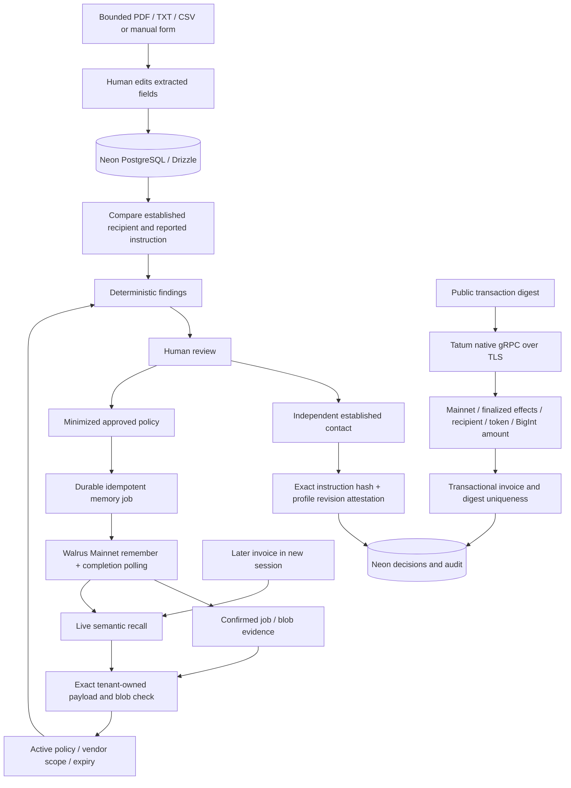

# Architecture

PayGuard Verify is a single-owner Next.js application. Public routes return explicitly synthetic fixtures. Server routes validate the session, origin, tenant ownership, input schema and quotas before touching owner records or providers. There is no transaction-signing path.

## Persistence and concurrency

Migrations `0000` and `0001` are additive; they were applied successfully to configured Neon. The original 19 tables retain invoices, vendor references, payment instructions, human attestations, decisions, policy JSON, memory jobs/recalls, candidates/matches, rate limits and audit events. Existing migrations were not rewritten. Additive `0002`/`0003` bring the total to 21 tables with service intents and receipts.

`vendor_trust_profiles` is the current established reference. Each update increments its revision and records previous/current recipients in the audit trail. `human_verifications` binds an outcome to the full invoice/instruction hash and that revision; a later change invalidates the attestation. These are human assertions, not cryptographic vendor identity. This MVP uses a single active reference per vendor plus invoice-scoped attestations rather than a general multi-destination registry with all five destination lifecycle statuses.

Approval locks the invoice and vendor while checking the gate. Confirmed chain matches recheck the immutable payment terms and enforce unique tenant/network/digest and tenant/invoice indexes. No USD/SUI conversion is implicit. Deleting a matched invoice is refused; resetting synthetic scenarios retains memory and audit proof.

## Memory safety

A durable operation key precedes the provider call. The accepted job ID is saved before polling. Leases avoid concurrent workers; idempotency keys protect the accepted-but-not-persisted retry window. Pending status survives HTTP/process interruptions. Only a matching completed job, namespace and blob can become confirmed.

Recalled text is untrusted. Exact stored text and blob ID must match an authorized confirmed record. Policy JSON in Neon supplies the allowed deterministic action; a recalled instruction cannot invent a tool. Scope, synthetic/real isolation, currency, expiry and supersession constrain application. New exception context requires a current confirmed human attestation, is invoice-scoped, expires after 30 days, and cannot suppress safety checks. Seed events are explicitly synthetic. Older seed exception context is informational and never approves anything.

Memory OFF does not invoke semantic recall. It keeps baseline detection and mandatory rules. ON applies only actually returned, applicable citations. Review audit events distinguish fetched memories from those that influenced a finding.

## Provider and deployment boundaries

Walrus is pinned to the managed Mainnet relayer. Tatum is pinned to native TLS gRPC with server-side `x-api-key`. Node route handlers use bounded calls and return unavailable/error states; there is no fabricated fallback. Manual digest lookup is the reliable demonstration path; bounded streaming discovery is provider-dependent, not complete archival history.

A local PGlite fallback exists only for explicit local QA, is labeled, and cannot enable live memory or run on Vercel. Production persistence is Neon. Secrets are never passed to client components. Vercel must receive its own environment settings and exact production `APP_URL`.

## Judge and service-payment extension

`/try` uses the existing deterministic rules and approval gate with synthetic input and a whitelisted captured recall artifact. The same React component is bundled for the public GitHub Pages sandbox; it performs no anonymous provider calls or writes. The capture script queries the authenticated SDK and publishes only synthetic scoped policies with exact confirmed citations. Public replay and live owner recall are explicitly distinguished.

Two additive service tables preserve owner-approved x402 Testnet intents and unique receipts. A signed nonce, frozen instruction snapshot, exact term allowlist and pre-settlement claim prevent rebinding or duplicate charges. Finality is independently checked through Tatum before a result is delivered. Service fees are isolated from supplier invoices; no supplier payment path exists. Mainnet service settlement is unconditionally disabled. See [agent payments](AGENT_PAYMENTS.md).
