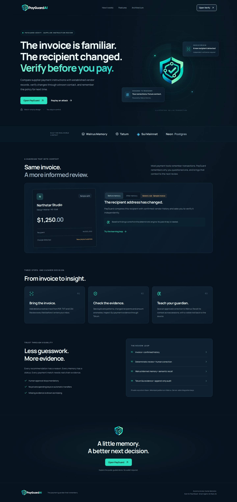
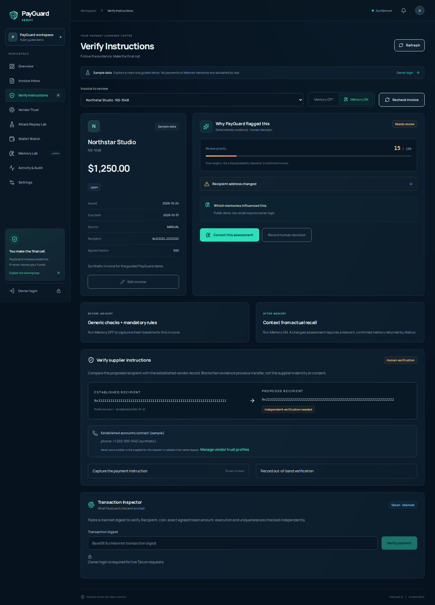

# The invoice was familiar. The recipient was not.

_Technical article source, updated October 28, 2026. Mainnet results are measured; see the test ledger for hosted deployment status._

[Repository](https://github.com/sopskistar/payguard-ai) · [Proof ledger](MAINNET_PROOF.md) · [Test results](TEST_RESULTS.md)

A payment request can look routine while changing the one detail that matters: who gets paid. The FBI's [business email compromise guidance](https://www.fbi.gov/how-we-can-help-you/common-frauds-and-scams/business-email-compromise) describes vendor impersonation, subtle address changes and compromised correspondence. It recommends independently verifying changes using a known channel. PayGuard Verify turns that review practice into an observable workflow.

## Start with a reference, not a score

The application records a vendor's established recipient, email domain and independent contact. A new instruction is compared against that reference. Changed recipients, mismatched reply-to details, urgency and instructions to skip verification become explicit findings. We do not call the resulting rule score a fraud probability. A matching email domain does not authenticate a message, and a syntactically valid wallet does not prove supplier control.

## The human establishes the fact

A reviewer contacts the supplier through the previously established channel and records what happened. The attestation is bound to an instruction snapshot and vendor-profile revision. Editing either invalidates it; concurrent edits and approvals use database row locks. These records are human assertions, not claims that our app observed a phone call. No supplier payment is initiated.

## Walrus remembers why

Corrections become minimized policy templates with pseudonymous references. Raw invoice documents, correspondence, contacts and detailed explanations are not sent to Walrus. The server uses the Walrus Memory delegate SDK, records an accepted job ID durably, and waits for a completed result before showing a confirmed blob. A timeout remains pending and resumes the same job.

When a later invoice is reviewed, semantic recall queries the owner's stable namespace. Returned content is untrusted until it matches the exact confirmed tenant-owned payload. The deterministic engine then applies the matching authoritative policy, with a visible citation. Memory OFF removes learned soft-policy application while retaining mandatory checks. An empty recall result produces no invented improvement.

On October 28 we confirmed all twelve distinct seeded policies on Walrus Mainnet. These are fictional business events with real storage receipts. The first seed's job was `4d590890-db79-4329-986f-10f52d32d5c7`, returning blob `pPYsV-RKCESYlutuJDdc9lj9pxV2ixSA_zMHRDr2CM4`. Interrupted writes resumed their accepted IDs; no pending job entered the confirmed count.

A new server process reviewed a later Northstar sample invoice at `2026-10-28T14:06:45.669Z`. OFF retained recipient-change warnings. ON retrieved twelve confirmed memories and applied three matching vendor policies, moving the review from “Needs review” to “High risk / verification required.” The proof file records the exact returned citations; this was not a local policy lookup dressed as recall.

A separate browser experiment then created a thirteenth confirmed memory, logged out, closed the first context, signed in through a new context, and reviewed a later invoice. The test passed in 56.8 seconds: the new assessment cited the exact blob written in the first session. Neither OFF nor ON bypasses the independent-verification gate. [Completion and recall evidence](MAINNET_PROOF.md) includes all thirteen job/blob pairs.

## Tatum supplies a different kind of evidence

The backend uses native Sui Mainnet gRPC through Tatum, with TLS and a server-only API key. It verifies service identity, fetches transaction effects and balance changes, resolves coin decimals, and compares exact atomic units. Gas-payer rebates are excluded from payment matching. Fiat invoices need an explicitly agreed token amount. Database uniqueness protects against digest reuse.

This chain evidence answers whether the expected address received the expected token amount. It does not answer whether the supplier authorized the instruction. Keeping those questions separate is central to the product.

Tatum identified Sui Mainnet as `35834a8a` and reported service checkpoint `339079915`. We inspected the real public digest `os1iG8zow278c6hqxbuyxnvMUjzThsD8GTY8atdfzW6`, finalized in checkpoint `339078672`. Its successful execution did not prove a payment to our sample vendor: the transaction showed a SUI debit from its sender, while the sample recipient received zero. Live coin metadata returned nine decimals. Our reconciliation returned **Mismatch** against the synthetic expectation of `500000000000` atomic units.

That negative result is useful. A successful transaction pasted into a review must not become a fabricated receipt. No transfer was sent and no invoice was marked paid. Positive matching remains covered by synthetic fixtures; this article makes no claim of a real positive supplier payment. Tip discovery was intermittent, so the demo uses the actual known digest with honest provider failures.

## What we tested and what remains

The automated suite covers attack replay controls, changed-recipient gates, stale human verification, parsing, reconciliation edge cases and durable memory state transitions. Provider fixtures are explicitly synthetic. Local PostgreSQL tests establish application behavior, not Neon or Mainnet connectivity. Fresh-session learning was demonstrated separately with live credentials; hosted deployment validation is recorded independently in the test ledger.

Memory is subject to retention epochs and semantic indexing delays. Deterministic patterns can miss attacks or flag legitimate requests. Our audit is append-only through the app, not immutable against a database administrator. These limits remain visible rather than hidden behind a confidence badge.

The narrow MVP deliberately uses a single active supplier reference with invoice-scoped attestations, rather than claiming a complete vendor identity system. The replay includes changed recipients, lookalike domains, compromised threads, a negative control, duplicates, legitimate exception context and the exact prompt-injection phrase from our adversarial test. New exception memories require a current independent attestation, remain invoice-scoped and expire after thirty days.

This article is [published on GitHub Pages](https://sopskistar.github.io/payguard-ai/). Production is public at https://payguard-ai-henna.vercel.app/ and hosted owner/Neon/Walrus/Tatum smoke testing has passed. The remaining submission work includes the owner-arranged demonstration and required account/dashboard details. The repository contains the application, reproducible checks and reviewed real evidence. No x402/MPP settlement or payment bonus is claimed.

## Follow-up: thirty memories and a public judge journey

The original thirteen Mainnet records were rechecked through the SDK. We then added seventeen distinct business-event policies through the sponsored managed relayer, using stable operation keys and a hard 30-operation cap. Accepted pending jobs resumed their original IDs; all thirty confirmed. No wallet funding or storage-renewal transaction was sent.

A fresh live evaluation applied relevant policies in all four supplier scenarios, retained all baseline findings, applied zero expired/superseded/wrong-vendor rules, and added zero critical warnings to one unchanged control. The relayer returned thirty candidates per query, so this is a bounded application-policy test rather than a large-scale retrieval benchmark.

The [public three-minute judge sandbox](https://sopskistar.github.io/payguard-ai/try/) uses the same protection functions and a dated capture of real semantic recall. It exposes no private data or write endpoints. The owner workflow continues to use live SDK calls and Neon persistence.

A controlled Testnet x402 service-fee workflow is implemented for first-party consistency analysis. Exact owner approval, wallet signing, quote nonce, replay prevention and independent Tatum receipt checks precede result delivery. No real service payment has settled through it yet, and Mainnet settlement is disabled. We claim no agent-payment award completion. The public production app is now available at https://payguard-ai-henna.vercel.app/ with the seven-step judge sandbox at `/try`. Wallet personal-message authentication creates isolated member accounts; owner administration remains separate. The owner will arrange the demonstration video separately; no video was created by this build.

## A measurement that caught a real false alarm

An expanded 18-case synthetic suite reused four actual Walrus recalls. Its first run met 15 contracts and exposed three extra warnings on unchanged, established recipients with little invoice history. The correction anchored the learned comparison to the independently established supplier reference. Re-running the suite met all 18 contracts while retaining all baseline findings; zero of four unchanged controls gained a critical warning, and no stale or wrong-scope policy applied. Sixteen scenarios applied recalled context. Only 10.9% of returned candidate/case combinations were applicable, so broad retrieval and strict scope filtering remain visible limitations. These are small authored contract checks, not real-world fraud accuracy. Both runs and all blob citations are published in the [learning report](https://payguard-ai-henna.vercel.app/proof#learning).

## Wallet control is not supplier identity

The modern Mysten React dApp Kit discovers Wallet Standard wallets. A displayed, five-minute personal message binds a nonce, domain, wallet and login purpose to the current browser. Backend signature verification and atomic one-time consumption precede profile/session creation. Invoices, contacts, rules, audits and exact confirmed memory provenance are tenant-scoped. Wallet connection alone grants no access, member accounts cannot invoke administrator operations, and no login message can send funds. Storage remains operator-managed; wallet ownership does not certify a supplier or turn this into encrypted decentralized personal storage.
